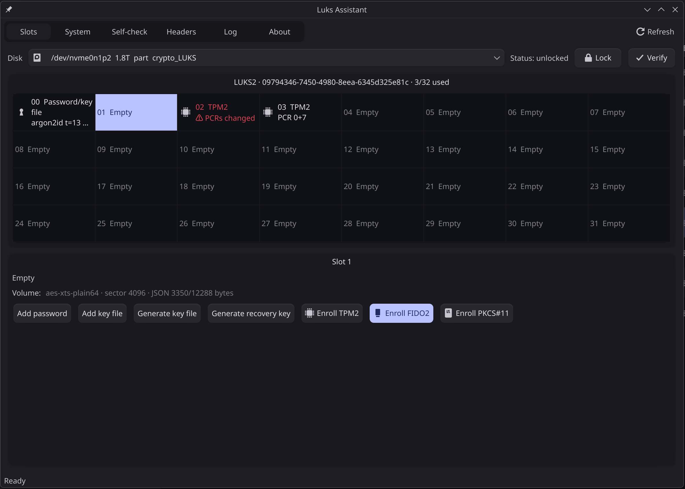

<p align="center"></p>

<h1 align="center">Luks Assistant</h1>

**Luks Assistant** manages LUKS key slots: passphrases, key files, recovery keys, TPM2 (with a choice of PCRs), FIDO2 security keys, PKCS#11 smart cards, plus slot notes, priorities, header backup/restore, and more.
It uses `cryptsetup` and `systemd-cryptenroll` under the hood, so it works on all three major distribution families: Arch, Fedora/RHEL, and Debian/Ubuntu.

> **LUKS2 only; legacy LUKS1 is not supported.** Luks Assistant never modifies LUKS1 volumes.

- **GUI** `Luks-Assistant-GUI`: a native Qt6 Widgets interface (uses the system style on KDE; on GNOME it follows the Qt platform theme for a GTK look). Runs as a regular user and starts the root backend `Luks-Assistant-Helper` through `pkexec`
- **TUI** `Luks-Assistant-TUI`: run with `sudo`; well suited to servers and SSH sessions

<p align="center"></p>

## Features

- **Overview of all 32 slots**: type, KDF, priority, tokens, notes, and whether each TPM2 policy still matches the current PCRs
- **Passphrases / key files**: add, change, generate random key files (0400), and find out which slot a passphrase unlocks
- **Recovery keys**: generate / regenerate
- **TPM2**: choose your PCRs, optional PIN, **one-click re-enrollment**
- **PCR drift detection**: recomputes systemd's TPM2 policy hash locally and compares it with the token to tell whether automatic unlocking will still work
- **FIDO2 / PKCS#11**: enroll, re-enroll
- **Slot notes**: stored in the LUKS2 header by default, or locally in `/etc/luks-assistant/`
- **Self-check**: problems and warnings (orphaned tokens, stale notes, TPM policy mismatches, etc.); hardware unlock availability (read-only: initramfs hooks, crypttab, kernel parameters, token plugins, Secure Boot, etc., to tell whether TPM2/FIDO2 unlocking will work at boot)
- **Header management**: back up / restore LUKS headers, with a configurable backup location
- **Unlock / lock**: open and close volumes with a passphrase, a key file, or a TPM2/FIDO2/PKCS#11 token
- **PBKDF2 → Argon2id** conversion
- **Verify**: check that a passphrase, key file, or TPM2/FIDO2/PKCS#11 token works
- **Interface language**: English and Simplified Chinese, chosen on the GUI's "About" page (follows the system by default); the TUI follows the locale. Translations are standard gettext catalogs in `po/`; see [CONTRIBUTING.md](CONTRIBUTING.md) to add a language
- **Log**

## Safety guardrails

- **At least one passphrase / key file / recovery key slot is always kept.** TPM2, FIDO2, and other tokens can never be the only way to unlock.
- Deleting a slot requires the credentials of **another** remaining slot and typing the slot number to confirm.
- Before every header change, the header is backed up automatically to `<UUID>/` under the backup location.
- The full **equivalent commands** are shown before anything runs; secrets are passed through anonymous pipes (`/dev/fd/N`) or systemd-cryptenroll's environment variables.
- After every operation the header is read back to verify that the result is as expected.
- A warning is shown when a new passphrase contains non-ASCII characters.
- Operations are logged with secrets redacted.

## Installation

- `Luks-Assistant-x86_64.tar.gz`
- `Luks-Assistant-aarch64.tar.gz`

```sh
tar xf Luks-Assistant-x86_64.tar.gz && cd Luks-Assistant-x86_64
sudo ./install.sh                # installs to /usr/local, including the polkit policy and desktop entry
sudo ./install.sh --uninstall
```

Runtime dependencies: `cryptsetup` ≥ 2.4; TPM2/FIDO2/PKCS#11/recovery keys need `systemd-cryptenroll` (systemd ≥ 248; TPM2+PIN needs ≥ 251); the GUI needs polkit (`pkexec`) and Qt 6 Widgets (Arch `qt6-base`, Fedora `qt6-qtbase-gui`, Debian/Ubuntu `libqt6widgets6`). Features are enabled automatically based on tool versions.

## Building from source

Requires Rust ≥ 1.85; the GUI also needs CMake and the Qt ≥ 6.2 development packages (Arch `qt6-base`, Fedora `qt6-qtbase-devel`, Debian/Ubuntu `qt6-base-dev`).

```sh
cargo build --release                            # TUI and helper
cmake -S gui -B gui/build -DCMAKE_BUILD_TYPE=Release && cmake --build gui/build   # GUI
sudo packaging/install.sh                        # installs the binaries from target/release and gui/build
sudo ./target/release/Luks-Assistant-TUI /dev/nvme0n1p2 # run the TUI directly
./target/release/Luks-Assistant-TUI --dump disk.img     # print the slot model as JSON
```

## Slot notes

Luks Assistant lets you attach a note to each slot.

- **In the header** (default): all notes live in **a single** `luks-assistant-notes` token that is not bound to any slot (`"keyslots": []`). If it were bound to slots, `systemd-cryptenroll --wipe-slot` wiping one of them would also wipe the other slots sharing the same token. Each note records a fingerprint of its slot's KDF salt; when another tool deletes or rewrites the slot, the note becomes invalid automatically and the self-check suggests cleaning it up.
- **On this machine**: `/etc/luks-assistant/notes/<UUID>.json` (0600).

## Project layout

```
crates/
├── luks-assistant-sysinfo  read-only system probing: distribution, tool versions and features, UEFI/Secure Boot, TPM, PCRs, FIDO2/PKCS#11, boot checks
├── luks-assistant-core     header parsing, 32-slot model, notes, PCR policy computation, safety guardrails, forms, operation planning and execution, protocol
├── luks-assistant-tui      ratatui terminal interface (library + Luks-Assistant-TUI binary)
└── luks-assistant-helper   root backend Luks-Assistant-Helper, started by the GUI through pkexec
gui/                        C++ Qt6 Widgets GUI (Luks-Assistant-GUI; switches to the TUI when started in a terminal)
packaging/                  polkit policy, desktop entry, install script
```
